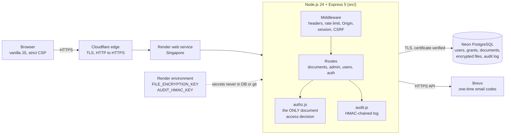
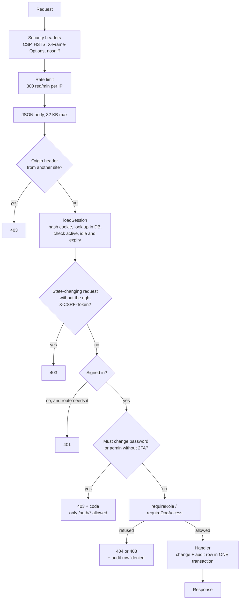
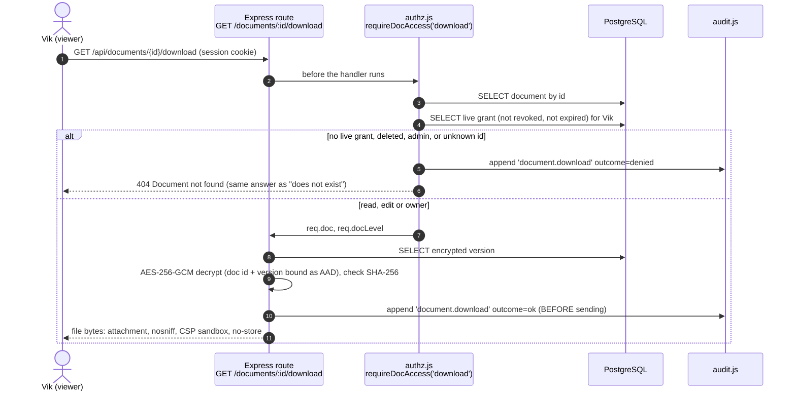
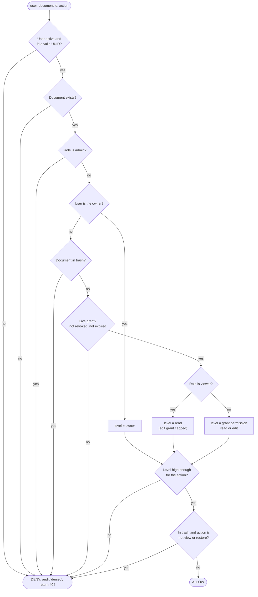
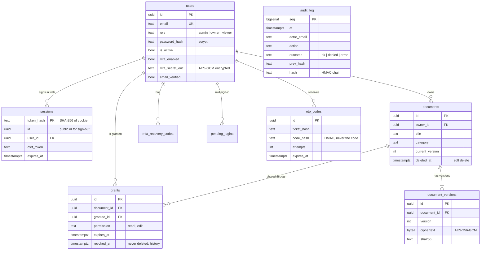
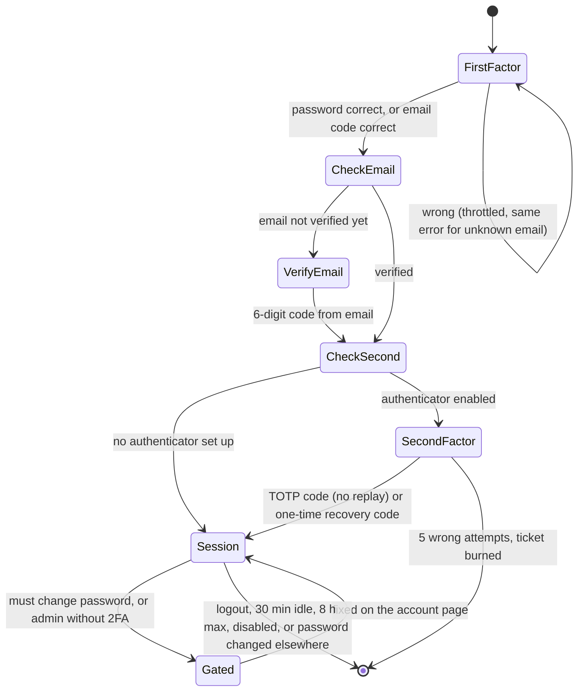
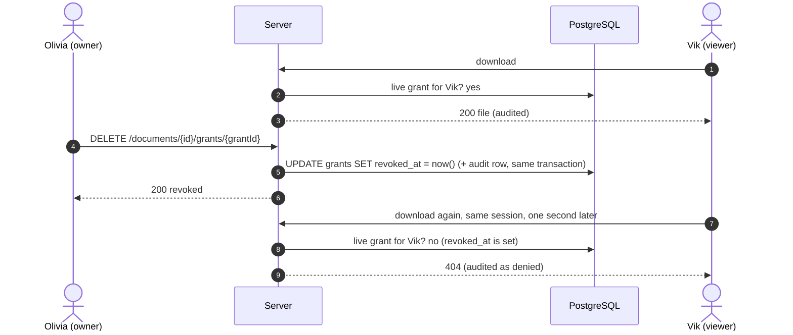
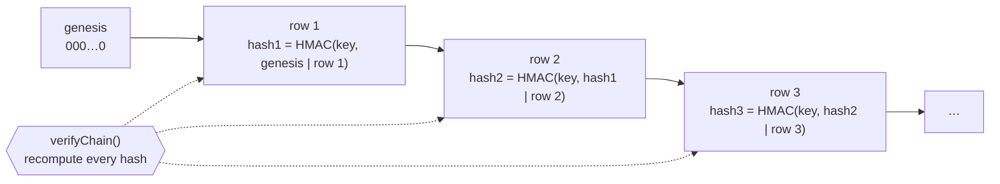

# TrustVault architecture

Diagrams of how TrustVault is put together and how it decides who can reach a document.
Every box below maps to real code; file names are given so each claim can be checked.

1. [System overview](#1-system-overview)
2. [Request pipeline](#2-request-pipeline)
3. [Downloading a document, step by step](#3-downloading-a-document-step-by-step)
4. [The access decision](#4-the-access-decision)
5. [Data model](#5-data-model)
6. [Signing in](#6-signing-in)
7. [Revocation](#7-revocation)
8. [The tamper-evident audit chain](#8-the-tamper-evident-audit-chain)

---

## 1. System overview

- **No file system storage.** File bytes are AES-256-GCM encrypted and stored in
  `document_versions.ciphertext`; there is no path a web server could serve.
- **Keys live apart from data.** The encryption and HMAC keys are host environment variables,
  so a copy of the database alone cannot decrypt files or forge audit entries.
- **Locally and in tests** the same code runs on PGlite (PostgreSQL compiled to WebAssembly),
  so the triggers and SQL are identical to production.

## 2. Request pipeline

Order matters: every `/api` request passes these layers before any handler runs (`src/app.js`).

## 3. Downloading a document, step by step

What the interview question "where is the authorisation decision made when someone downloads
a file?" refers to (`src/routes/documents.js` → `src/authz.js`).

If `requireDocAccess('download')` is removed from that route, anyone with a session gets
any file, and 12 of the 83 tests fail.

## 4. The access decision

`effectiveAccess()` and `authorizeDoc()` in `src/authz.js`. Anything not explicitly allowed is denied.

| Level | Allows |
|---|---|
| `read` | view metadata, list versions, download |
| `edit` | read + rename, re-describe, re-categorise, upload a new version |
| `owner` | edit + delete, restore, share, revoke, see grants, see activity |

## 5. Data model

Full definition in [`db/schema.sql`](../db/schema.sql).

`audit_log` is deliberately unlinked by foreign keys, so evidence survives anything that
happens to users or documents. Triggers reject `UPDATE`, `DELETE` and `TRUNCATE` on it.

## 6. Signing in

`src/auth.js`. A session is created only after every required factor is proven.

## 7. Revocation

Why "taking access away" works on the very next request: nothing that outlives the decision
is ever issued (no signed URLs, no JWTs, no cached permissions).

Disabling a user deletes every session row and is also re-checked on every request; deleting
a document, an expired grant and an ownership transfer all take effect the same way.

## 8. The tamper-evident audit chain

`src/audit.js`. Each row's hash covers the previous row's hash, with a key that is not in the
database.

| Attack | Result |
|---|---|
| `UPDATE` / `DELETE` / `TRUNCATE` through SQL | Rejected by database triggers |
| Disable triggers, then edit a row | That row's hash no longer matches: reported at that entry |
| Delete a row | The next row's `prev_hash` points at nothing: reported at the next entry |
| Insert a forged row | Cannot compute a valid HMAC without the key: reported |
| Steal the database **and** the server's key | Not prevented: listed as accepted risk T-17b in THREATS.md |
